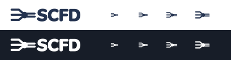

# WoW2 SCFD

SCFD stands for **Source Collection and Feed Delivery**. It collects from scheduled sources, normalizes records and
delivers updates to connected products. SCFD Adapters supplies private sources and egress over the public engine.

## Naming

| Surface | Name |
|---|---|
| Platform catalog, wordmark and standalone demo | SCFD |
| Full product name | WoW2 SCFD |
| Public solution | `SCFD.BackendServices.slnx` |
| Private runtime and solution | SCFD Adapters · `SCFD.Adapters.BackendServices.slnx` |
| GitHub checkouts | `wow-two-sdk-beta.harvest` · `wow-two-sdk-beta.harvest-adapters` |
| SDKs | `WoW2.Sdk.Beta.Be.Harvest.*` · `@wow-two-beta/fe-harvest` |
| Deployment IDs | `harvest` · `harvestadapters` |

The existing integration vocabulary uses `Harvest` for C# symbols and configuration, and `harvest` for runtime
service and migration IDs. The shared Rider project dictionaries accept `scfd` in folder and solution views.

## Artwork


Three source channels converge at the collection junction and fan out as two feed channels. The four uppercase
letters are generated raster artwork in a Nunito Sans-inspired weight and spacing. The draft appears in the
standalone demo. The API is the integration surface and consumers own their presentation.

| Composition | Export | Placement |
|---|---|---|
| Horizontal logo | [820 × 163 PNG](../../engineering/codebase/harvest.frontend-services/apps/web/src/presentation/console/assets/scfd-logo.png) | Demo header at 28 CSS px high |
| Standalone mark | [Light](icons/short-colored-light.png) · [Dark](icons/short-colored-dark.png) | 800 × 800 PNG for Wheelhouse |
| Favicon | [Light](../../engineering/codebase/harvest.frontend-services/apps/web/public/favicon.png) · [Dark](../../engineering/codebase/harvest.frontend-services/apps/web/public/favicon-dark.png) | 256 × 256 PNG for the standalone demo |
| Touch icon | [180 × 180 PNG](../../engineering/codebase/harvest.frontend-services/apps/web/public/apple-touch-icon.png) | White mark on an opaque navy tile |

Keep at least one quarter of the visible mark height around the logo. Use the navy artwork on light surfaces and
render the same alpha mask in white on dark surfaces. Use at least a 24 CSS px square for the standalone mark where
the channel details matter.



The review shows the 28 CSS px header and the standalone mark at 16, 20, 24 and 32 CSS px from left to right.

## Source and exports

The [transparent raster master](scfd-master.png) is the original 2172 × 724 built-in image-generation output.
The derived artwork uses WoW2 navy `#23324F` and white. SHA-256 of the master is
`ca0f4e542eab78c675957112d16d051c23671bf54d2ce9a8a8687e504b4bfeef`.
The [export script](../../engineering/scripts/export-scfd-brand.sh) uses FFmpeg to crop the master, apply the two
inks and export the logo, marks, browser icons and review sheet. SCFD Adapters uses the same two Wheelhouse marks.

```sh
bash engineering/scripts/export-scfd-brand.sh /tmp/scfd-artwork
```
